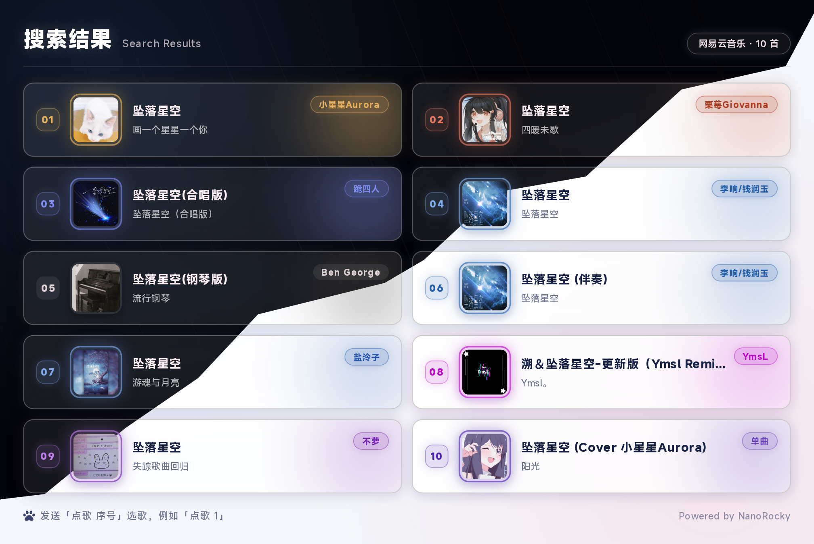

<!-- omit in toc -->
# 初叶🍂 MetingAPI 点歌插件

<p align="center">
  
  
  
  
</p>

<p align="center">
  <b>基于 MetingAPI 的多音源点歌插件</b><br>
  支持 QQ 音乐 · 网易云 &nbsp;|&nbsp; 智能语音分段 &nbsp;|&nbsp; 精美音乐卡片
</p>

---

> [!WARNING]
> **兼容性声明**
> - 使用音乐卡片功能，AstrBot 版本须 ≥ `4.17.6`
> - 遇到问题时请开启 **DEBUG 日志**，查看插件运行日志
> - 提交 Issue 时请附带：插件日志、AstrBot & 插件版本、消息平台框架

<!-- omit in toc -->
## 📑 目录

- [✨ 功能特性](#-功能特性)
- [📦 安装](#-安装)
- [🎮 使用方法](#-使用方法)
  - [📋 指令速查表](#-指令速查表)
  - [🔍 搜索歌曲](#-搜索歌曲)
  - [▶️ 播放歌曲](#️-播放歌曲)
  - [🔄 切换音源](#-切换音源)
  - [🔄 切换模式与主题](#-切换模式与主题)
  - [🎨 音乐卡片](#-音乐卡片)
  - [🤖 LLM 调用](#-llm-调用)
- [⚙️ 配置说明](#️-配置说明)
  - [基础配置](#基础配置)
  - [API 配置](#api-配置)
  - [搜索配置](#搜索配置)
  - [搜索数据展示设置](#搜索数据展示设置)
  - [音乐发送配置](#音乐发送配置)
  - [音乐卡片配置](#音乐卡片配置)
  - [下载与缓存配置](#下载与缓存配置)
  - [语音分段配置](#语音分段配置)
- [🔧 技术说明](#-技术说明)
- [❓ 常见问题](#-常见问题)
- [📂 项目结构](#-项目结构)
- [🙏 致谢](#-致谢)
- [📜 许可证](#-许可证)

---

## ✨ 功能特性

| 特性 | 说明 |
|------|------|
| 🎵 **多音源支持** | QQ 音乐、网易云、酷狗、酷我（取决于 API） |
| 🖼️ **图片搜索结果** | 带封面的歌曲列表，支持浅色/深色/定时主题切换与开关控制，失败时自动回退文字 |
| 💬 **会话级音源** | 每个会话独立切换音源，互不影响 |
| ✂️ **智能分段** | 超长歌曲自动分割发送，支持 30~300s 可配置分段 |
| 🎨 **音乐卡片** | 精美卡片消息，含封面、歌手、跳转链接 |
| ⚡ **快捷点歌** | 一键指定音源直接点歌，无需切换 |
| 🤖 **LLM 友好** | 提供 Function Tool，AI 可直接调用搜歌/点歌 |
| 🗑️ **自动撤回** | 搜索结果定时撤回，保持聊天整洁 |
| 🔒 **结果隔离** | 可选搜歌结果仅对搜索者本人有效 |
| 📁 **文件直传** | 支持以文件方式发送音乐，绕过语音限制 |
| 💾 **缓存机制** | 可选缓存已下载音乐，减少带宽消耗 |

---

## 📦 安装

<details open>
<summary><b>方式一：WebUI 安装（推荐）</b></summary>

1. 打开 AstrBot WebUI → **插件市场**
2. 搜索 `meting`
3. 找到本插件并安装
4. 启用插件并配置

</details>

<details>
<summary><b>方式二：WebUI 手动安装</b></summary>

1. 打开 AstrBot WebUI → **插件管理**
2. 点击 **从链接安装**
3. 输入：`https://github.com/chuyegzs/astrbot_plugin_meting/`
4. 启用插件并配置

</details>

<details>
<summary><b>方式三：手动安装</b></summary>

```bash
# 进入插件目录
cd AstrBot/data/plugins

# 克隆仓库
git clone https://github.com/chuyegzs/astrbot_plugin_meting.git

# 安装依赖
cd astrbot_plugin_meting
pip install -r requirements.txt
```

然后在 WebUI 插件管理页面启用即可。

</details>

> 💡 插件依赖 `aiohttp`、`imageio-ffmpeg`、`py-machineid`，WebUI 安装时会自动处理；封面主题取色可选复用 AstrBot 内置的 `Pillow`（缺失时自动降级为无色玻璃卡片）。

---

## 🎮 使用方法

### 📋 指令速查表

| 指令 | 别名 | 说明 |
|------|------|------|
| `点歌指令` | `点歌帮助` `点歌说明` `点歌指南` `点歌菜单` `song help` `meting help` | 查看所有指令 |
| `搜歌 <歌名>` | `mting-search` `mting-search song` | 在当前音源搜索歌曲 |
| `点歌 <序号>` | `mting-play` `mting-play song` | 播放搜索结果中的歌曲 |
| `点歌 <歌名>` | `mting-play` `mting-play song` | 直接搜索并播放第一首 |
| `网易点歌 <歌名>` | `网易云点歌` `netease play` `netease song` | 网易云快捷点歌 |
| `QQ点歌 <歌名>` | `腾讯点歌` `QQ音乐点歌` `tencent play` `qq play` | QQ 音乐快捷点歌 |
| `酷狗点歌 <歌名>` | `酷狗音乐点歌` `kugou play` | 酷狗快捷点歌 |
| `酷我点歌 <歌名>` | `酷我音乐点歌` `kuwo play` | 酷我快捷点歌 |
| `切换网易云` | `切换网易` `切换网易云音乐` `switch netease` | 切换会话默认音源为网易云 |
| `切换QQ音乐` | `切换腾讯音乐` `switch tencent` `switch qqmusic` | 切换会话默认音源为 QQ 音乐 |
| `切换酷狗` | `切换酷狗音乐` `switch kugou` | 切换会话默认音源为酷狗 |
| `切换酷我` | `切换酷我音乐` `switch kuwo` | 切换会话默认音源为酷我 |
| `切换搜歌主题 <theme>` | `mting-切换搜索主题` `mting-切换图片主题` `mting-切换主题` `mting-switch theme` | 切换会话搜歌图片主题（浅色/深色/自动/默认） |
| `切换搜歌展示 <mode>` | `切换搜歌模式` `mting-切换搜索展示` `mting-切换搜索模式` `mting-switch search mode` | 切换会话搜歌展示方式（图片/文本/默认，仅管理员） |
| `切换发送模式 <mode>` | `切换点歌模式` `switch meting mode` | 切换会话的发送模式（仅管理员） |

### 🔍 搜索歌曲

使用当前会话设置的音源搜索：

```
搜歌 坠落星空
```

搜索结果以图片列表显示，包含序号、封面、歌名、歌手和专辑：



图片使用 AstrBot 的 T2I 服务渲染，生成或发送失败时自动回退为文字。

文本格式示例：

```
🎵 猫猫为你找到的歌曲 (网易云音乐)
━━━━━━━━━━━━━━
[1] 坠落星空  👤 小星星Aurora  💿 画一个星星一个你
[2] 坠落星空  👤 栗莓Giovanna  💿 四暖未歇
[3] 坠落星空(合唱版)  👤 跪四人  💿 坠落星空（合唱版）
[4] 坠落星空  👤 李响/钱润玉  💿 坠落星空
[5] 坠落星空(钢琴版)  👤 Ben George  💿 流行钢琴
[6] 坠落星空 (伴奏)  👤 李响/钱润玉  💿 坠落星空
[7] 坠落星空  👤 盐泠子  💿 游魂与月亮
[8] 溯＆坠落星空-更新版（Ymsl Remix）  👤 YmsL  💿 Ymsl。
[9] 坠落星空  👤 不萝  💿 失踪歌曲回归
[10] 坠落星空 (Cover 小星星Aurora)  👤 阳光
━━━━━━━━━━━━━━
💡 小贴士：发送 "点歌 1" 就可以让猫猫放第一首歌啦喵~
━━━━━━━━━━━━━━
🐾 Powered by NanoRocky
```

### ▶️ 播放歌曲

**通过序号播放**（需先搜歌）：

```
点歌 1
```

**直接点歌**（自动搜第一首）：

```
点歌 坠落星空
网易点歌 坠落星空
QQ点歌 坠落星空
```

### 🔄 切换音源

音源设置**按会话隔离**，切换后不影响其他群聊/私聊：

```
切换网易云
切换QQ音乐
切换酷狗
切换酷我
```

### 🔄 切换模式与主题

搜歌图片主题、搜歌展示方式与音乐发送模式均**按会话隔离**，切换后不影响其他群聊/私聊：

**所有人可用（会话级主题切换）**：

```
切换搜歌主题 浅色
切换搜歌主题 深色
切换搜歌主题 自动
切换搜歌主题 默认
```

**仅管理员可用（会话级展示与发送方式切换）**：

```
切换搜歌展示 图片
切换搜歌展示 文本
切换搜歌展示 默认

切换发送模式 卡片
切换发送模式 语音
切换发送模式 文件
切换发送模式 默认
```

### 🎨 音乐卡片

当 `send_as_music` 设为 `0`（默认）时，点歌会以精美卡片形式展示：<br><br>
【音乐卡片只支持 QQ 平台】

- 包含歌曲封面、歌名、歌手
- 点击可跳转到对应平台播放
- 非 QQ 平台自动降级为文件/语音发送

### 🤖 LLM 调用

插件暴露了 `astr_meting_music` Function Tool，AI 模型可直接调用：

- **搜索**：传入 `keyword` + `source`（默认 `"auto"` 同时搜索网易云与 QQ 音乐，也可指定单一音源），返回环境信息 `env`、`search_id`（含 `id`、`time`、`deadline`，有效期 60s）及带唯一序号（从 `0` 开始）的歌曲列表 JSON
- **播放**：在 `source` 中传入包含 `search_id` 与 `send_mode`（`"card"` 或 `"file"`）的 JSON，并指定歌曲序号 `index`（从 `0` 开始），优先发送音乐卡片，不支持时可切换为文件发送

---

## ⚙️ 配置说明

### 基础配置

| 配置项 | 类型 | 默认值 | 说明 |
|--------|------|--------|------|
| `bot_name` | 字符串 | `猫猫` | 回复消息与运行日志中机器人的自称（如 `猫猫`、`小助手`、`我`），留空则默认使用「猫猫」 |

### API 配置

| 配置项 | 类型 | 默认值 | 说明 |
|--------|------|--------|------|
| `api_url` | 下拉选择 | `https://musicapi.chuyel.top/meting/` | 预设 API 或选择 `custom` |
| `api_type` | 整数 | `1` | 仅自定义时生效：1=Node API, 2=PHP API, 3=自定义参数 |
| `custom_api_url` | 字符串 | — | 自定义 API 基础地址 |
| `custom_api_template` | 字符串 | — | 自定义参数模板（需含 `:server` `:type` `:id` `:r`） |

<details>
<summary><b>API 类型详解</b></summary>

| 类型 | 请求格式 |
|------|----------|
| **Node API** | `{api_url}/api?server={server}&type={type}&id={id}` |
| **PHP API** | `{api_url}?server={server}&type=search&id=0&keyword={kw}&dwrc=false` |
| **自定义参数** | 完全自定义，支持 `:server` `:type` `:id` `:r` 占位符 |

</details>

### 搜索配置

| 配置项 | 类型 | 默认值 | 范围 | 说明 |
|--------|------|--------|------|------|
| `default_source` | 字符串 | `netease` | — | 默认音源 |
| `search_result_count` | 整数 | `8` | 3~30 | 搜索结果数量（图片模式最多显示 12 首） |
| `search_result_expiration_time` | 整数 | `120` | 30~300s | 结果过期时间 |
| `search_results_withdrawn_after_timeout` | 整数 | `60` | -1~300s | 超时自动撤回；`0`=点歌后立即撤回；`-1`=不撤回 |
| `search_result_restrictions` | 布尔 | `false` | — | 搜索结果仅对搜索者本人有效 |

### 搜索数据展示设置

| 配置项 | 类型 | 默认值 | 可选值 | 说明 |
|--------|------|--------|--------|------|
| `render_search_result_as_image` | 布尔 | `true` | — | 是否使用图片展示搜索结果（关闭后直接以文本形式发送） |
| `image_theme` | 字符串 | `auto` | `auto`, `light`, `dark` | 图片主题色：`auto`（05:59 - 18:59 为浅色，其余时间为深色）、`light`（浅色）、`dark`（深色） |

### 音乐发送配置

| 配置项 | 类型 | 默认值 | 说明 |
|--------|------|--------|------|
| `send_as_music` | 整数 | `0` | `0`=音乐卡片，`1`=语音切片，`2`=文件发送 |
| `send_if_not_supported` | 整数 | `2` | 仅在 `send_as_music=0` 且非 QQ 平台时生效：`0`=不发送，`1`=语音切片，`2`=文件发送 |
| `send_music_info` | 整数 | `999` | 音质码率设置（范围 `-1`~`2147483`）：`999`=无损，`-1`=不限制（语音切片模式固定使用 `320` 节省带宽） |

### 音乐卡片配置

| 配置项 | 类型 | 默认值 | 说明 |
|--------|------|--------|------|
| `api_sign_url` | 字符串 | `https://oiapi.net/api/QQMusicJSONArk/` | 音乐卡片签名 API |

### 下载与缓存配置

| 配置项 | 类型 | 默认值 | 范围 | 说明 |
|--------|------|--------|------|------|
| `max_file_size` | 整数 | `80` | 10~200 MB | 最大下载文件大小 |
| `enable_cache` | 布尔 | `false` | — | 开启后缓存语音切片模式下载的原音频，减少重复下载与带宽占用 |
| `max_cache_size` | 整数 | `1` | 1~32 GB | 最大缓存占用；超出后自动按修改时间从旧到新清理至上限的 50% |
| `daily_cleanup_time` | 字符串 | `04:30` | HH:MM | 每日定时清理缓存时间（插件每次启动时也会清空缓存） |

### 语音分段配置

| 配置项 | 类型 | 默认值 | 范围 | 说明 |
|--------|------|--------|------|------|
| `segment_duration` | 整数 | `120` | 30~300s | 每条语音最大时长 |
| `send_interval` | 浮点 | `1.0` | 0~10s | 片段发送间隔 |

---

## 🔧 技术说明

### 音源映射

| 用户指令 | API 参数 |
|----------|----------|
| QQ 音乐 | `tencent` |
| 网易云 | `netease` |
| 酷狗 | `kugou` |
| 酷我 | `kuwo` |

### 语音分段机制

```
┌──────────┐    ┌──────────┐    ┌──────────┐
│ 原音频    │ → │ 转码 WAV  │ →  │ 分段发送  │
│ (任意格式)│   │ 24kHz单声道│   │ 每段 ≤120s│
└──────────┘    └──────────┘    └──────────┘
```

- 超过分段时长的歌曲自动切割
- 末尾剩余 ≤7s 时合并到最后一段，避免碎片
- 发送完毕后自动清理临时文件

### 数据存储

> 临时目录与缓存目录统一位于 Python 系统临时目录（`tempfile.gettempdir()`）下的插件专属子目录 `meting_nano` 中，不污染宿主或 AstrBot 数据目录。

| 数据 | 存储位置 | 生命周期与清理策略 |
|------|----------|--------------------|
| 会话音源 | 内存 | 重启/重载插件后重置（过期会话清理时保留已自定义的音源） |
| 搜歌结果 / LLM 搜索缓存 | 内存 | 搜歌结果按 `search_result_expiration_time`（默认 `120s`）过期清除；LLM 搜索结果 `60s` 后过期清除 |
| 临时音频（未开缓存的下载原音频 / 转码 WAV / 语音切片） | Windows：`%TEMP%\meting_nano\`<br>Linux / macOS：`/tmp/meting_nano/` | 播放结束后立即删除；异常残留文件超过 5 分钟后由后台任务自动清理；卸载插件时一并清理 |
| 音频缓存文件（仅在开启 `enable_cache` 且走语音切片模式时产生） | Windows：`%TEMP%\meting_nano\astrbot_meting_cache\`<br>Linux / macOS：`/tmp/meting_nano/astrbot_meting_cache/` | ① 插件启动与卸载时清空<br>② 到达 `daily_cleanup_time`（默认 `04:30`）时每日清空<br>③ 占用超过 `max_cache_size`（默认 `1GB`）时按最旧优先清理至上限的 50%（正在播放中的文件受引用计数保护，不会被误删） |

---

## ❓ 常见问题

<details>
<summary><b>Q: 提示"请先在插件配置中设置 MetingAPI 地址"</b></summary>

请在 AstrBot WebUI 的插件配置页面中选择或填写正确的 API 地址。

</details>

<details>
<summary><b>Q: 音乐卡片无法显示</b></summary>

1. 确认 AstrBot 版本 ≥ `4.17.6`
2. 检查 `api_sign_url` 签名服务是否可用
3. 确认当前消息平台为受支持的 QQ 协议端（如 NapCat / LLOneBot / Lagrange / aiocqhttp 等），并查看 DEBUG 日志中的卡片签名与发送记录

</details>

<details>
<summary><b>Q: 搜索歌曲提示"网络错误"</b></summary>

1. 检查 API 地址是否正确
2. 确认 API 类型选择是否匹配
3. 测试 API 是否可公网访问

</details>

<details>
<summary><b>Q: 播放歌曲提示音频处理组件依赖加载失败</b></summary>

请重新安装插件依赖（会自动安装内置 FFmpeg 的 `imageio-ffmpeg`），或在系统中安装 `ffmpeg` 并确保其位于 `PATH` 环境变量中：
```bash
pip install -r requirements.txt
```

</details>

<details>
<summary><b>Q: 非 QQ 平台如何发送音乐？</b></summary>

插件会自动检测消息平台，非 QQ 平台将按 `send_if_not_supported` 配置降级为文件或语音发送。

</details>

---

## 📂 项目结构

```
astrbot_plugin_meting/
├── main.py                  # 🔌 插件主入口与指令路由
├── src/
│   ├── assets/              # 🎨 静态资源目录
│   ├── core/                # 🧠 核心业务模块
│   │   ├── config.py        # ⚙️ 配置管理与类型校验
│   │   ├── session.py       # 💬 会话状态与搜索缓存管理
│   │   ├── api_client.py    # 🌐 MetingAPI 与卡片签名客户端
│   │   ├── audio.py         # 🎧 音频下载、本地缓存与 FFmpeg 切片
│   │   ├── sender.py        # 📤 消息发送编排、图片渲染与撤回
│   │   └── llm_handler.py   # 🤖 LLM 点歌工具逻辑
│   ├── utils/               # 🛠️ 通用常量与纯函数工具
│   │   ├── constants.py     # 📌 全局常量与自定义异常
│   │   └── helpers.py       # 🔧 URL/元数据规范化与平台探测
│   └── views/               # 🖼️ 视图模板目录
│       └── search.html      # 📄 搜索结果图片渲染模板
├── metadata.yaml            # 📋 插件元数据
├── _conf_schema.json        # ⚙️ 配置文件 Schema
├── requirements.txt         # 📦 Python 依赖
├── README.md                # 📖 说明文档
├── CHANGELOG.md             # 📝 更新日志
├── LICENSE                  # 📜 许可证
└── .gitignore               # 🙈 Git 忽略文件
```

---

## 🙏 致谢

|      |      |
|------|------|
| [初叶🍂 MetingAPI](https://github.com/chuyegzs/Meting-UI-API) | 二次开发的 MetingAPI 服务 |
| [MetingAPI](https://github.com/metowolf/Meting) | 原始音乐 API 服务 |
| [AstrBot](https://github.com/AstrBotDevs/AstrBot) | 多平台 LLM 聊天机器人框架 |
| [OIAPI](https://oiapi.net/) | 音乐卡片签名接口 |
| [NanoRocky](https://github.com/NanoRocky) | 功能添加与代码优化贡献者 |

---

## 📜 许可证

本项目基于 [AGPL License](LICENSE) 开源。

<br>

<p align="center">
  <sub>如有问题或建议，欢迎加入反馈 QQ 群：<b>535563643</b></sub>
</p>

